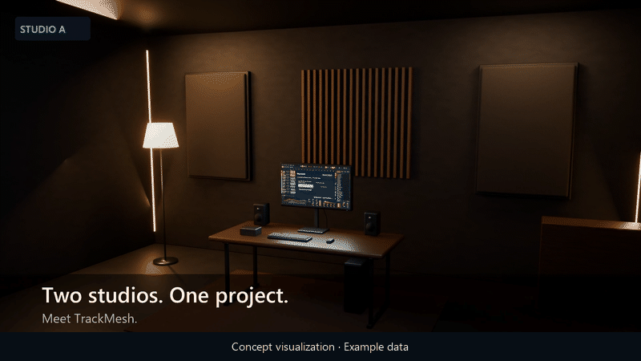
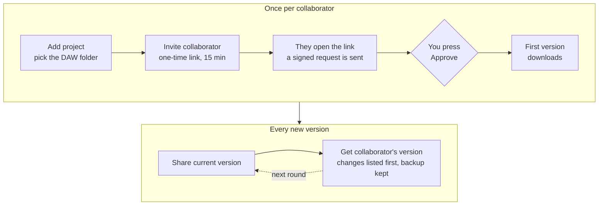
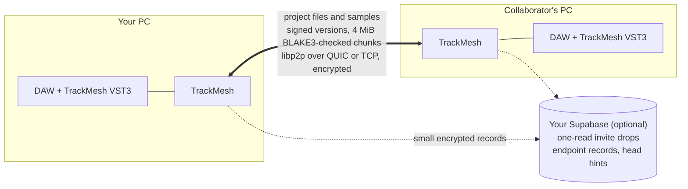

<p align="center">
  
</p>

<h1 align="center">TrackMesh</h1>

<p align="center">
  <b>Share DAW projects PC to PC.</b><br>
  Send Ableton Live and FL Studio project folders straight between your own PCs and your collaborators' PCs, on Windows.<br>
  Project files and samples travel directly between online PCs and never sit on a server.
</p>

<p align="center">
  <a href="https://github.com/ege-ozel/trackmesh/releases/latest"></a>
  
  
  <a href="LICENSE"></a>
  
</p>

<p align="center">
  <a href="https://github.com/ege-ozel/trackmesh/releases/latest"></a>
  &nbsp;
  <a href="https://github.com/ege-ozel/trackmesh/releases/download/v0.1.0/trackmesh-concept-video.mp4"></a>
</p>

<p align="center">
  <a href="#download">Download</a> ·
  <a href="#how-it-works">How it works</a> ·
  <a href="#requirements">Requirements</a> ·
  <a href="#current-limits">Current limits</a> ·
  <a href="docs/SECURITY.md">Security</a> ·
  <a href="docs/setup/README.md">Two-PC guide</a>
</p>

<p align="center">
  
  <br>
  <sub>Concept visualization with example data.</sub>
</p>

> [!NOTE]
> **Early preview (0.1.0).** Sharing has been checked live on one network, mostly between a PC and a Windows Sandbox on it; separate networks, carrier-grade NAT, audio in the DAW plugin and scaled displays have had little or no live testing. There are no automatic updates yet: install a newer version over the old one. See [Current limits](#current-limits) and [what has been checked](docs/IMPLEMENTATION.md).

<table>
  <tr>
    <td width="50%" valign="top"><b>Versions, not copies</b><br>Share current version saves the folder as a signed version. Your collaborator presses Get and sees which files change before anything is replaced. The previous files are kept as a backup.</td>
    <td width="50%" valign="top"><b>Only what changed travels</b><br>Files are split into 4 MiB chunks checked with BLAKE3, so a small edit to a large project sends only the changed part. A stopped download resumes from the chunks already downloaded and verified.</td>
  </tr>
  <tr>
    <td width="50%" valign="top"><b>Two or three devices per project</b><br>Every device is paired with an explicit approval, and the project creator can remove one later.</td>
    <td width="50%" valign="top"><b>No automatic merge</b><br>If both sides changed the project, TrackMesh asks which version to keep.</td>
  </tr>
</table>

## Download

Get `TrackMesh_<version>_x64-setup.exe` from the [latest release](https://github.com/ege-ozel/trackmesh/releases/latest) and run it on each PC. The release notes list its SHA-256 checksum; in PowerShell, `Get-FileHash .\TrackMesh_0.1.0_x64-setup.exe` should print the same value.

> [!WARNING]
> The installer is not code-signed, so Windows may warn before running it.

Downloaded builds contain no invite service. To use invite links, set up your own Supabase project as described under [Requirements](#requirements); invitation files under Advanced work without it.

## How it works



1. **Add project**: pick your DAW project folder.
2. **Invite collaborator**: copy a link. It works once and expires after 15 minutes.
3. Your collaborator opens the link (or uses **Paste invite link**) and accepts. You press **Approve**.
4. The first version downloads automatically into an empty folder on their PC.
5. From then on: **Share current version**, then **Get collaborator's version** on the other PC, with the project closed in the DAW.

The interface is in English or Turkish (Settings → Language). A step-by-step guide for two PCs (in Turkish) is in [docs/setup](docs/setup/README.md).

<details>
<summary><b>What travels where</b></summary>
<br>



- Files go only between the PCs, over an encrypted connection that checks the other side's device identity. Only approved devices can access project versions; temporary connections while an invite is open carry pairing messages only.
- Project files and file names are not uploaded to the optional invite service. Invite payloads, advertised endpoint records and head hints are encrypted; project secrets and the invite decryption key (kept in the link fragment) are not sent in plaintext. The service sees device public keys, route and device IDs, and request metadata such as connection addresses and times.
- Before **Get**, a dialog lists the files that will be added, changed or removed, and warns about program and script files. The replaced files are kept as a backup.

How pairing and approval work is explained in [PAIRING_SECURITY.md](docs/setup/PAIRING_SECURITY.md); the full picture is in [ARCHITECTURE.md](docs/ARCHITECTURE.md) and [SECURITY.md](docs/SECURITY.md).

</details>

<details>
<summary><b>Design decisions</b></summary>
<br>

- **Direct, not cloud.** DAW projects with samples are often gigabytes. Sending them PC to PC means no storage bill and no copy on someone else's server; the cost is that both PCs must be online at the same time.
- **Versions instead of live sync.** A DAW keeps a project open and rewrites it on save. Syncing files while the DAW has them open risks a half-written project, so a version is shared on purpose and applied only with the project closed.
- **No automatic merge.** DAW projects are structured, application-specific documents that TrackMesh does not know how to merge safely. Merging two edits could produce a project that does not open, so TrackMesh shows both sides and lets you choose; the other version is kept as a backup.
- **Approval, not just a link.** Anyone who sees an invite link could try to use it. The link only sends a signed request; the creator still compares the device identity and presses Approve.
- **No relay yet.** A relay needs a server someone runs and pays for. Its code is kept unbuilt in [future](future/README.md) for after 1.0.
- **Checked by hand, and written down.** Every live check, with its build and setup, is recorded in [IMPLEMENTATION.md](docs/IMPLEMENTATION.md), including what has not been checked.

</details>

<details>
<summary><b>Built with</b></summary>
<br>

| Part | Technology |
| --- | --- |
| Core and CLI | Rust, tokio, libp2p (QUIC, TCP/Noise), Ed25519, BLAKE3, SQLite |
| Desktop app | Tauri 2, React, TypeScript |
| DAW plugin | C++, Steinberg VST3 SDK |
| Invite service (optional) | Supabase: Postgres functions with row-level security, Edge Functions |
| Installer | NSIS via Tauri |

The code map for finding your way around is in [docs/CODEMAP.md](docs/CODEMAP.md).

</details>

## Requirements

- Windows 10 or 11, x64, with the Microsoft Edge WebView2 Runtime (current Windows has it; otherwise the installer downloads it).
- Both PCs online at the same time while a version transfers.
- For invite links: your own [Supabase](https://supabase.com) project with the TrackMesh invite service deployed ([services/supabase](services/supabase/README.md)); then enter its URL and publishable key in TrackMesh. It holds encrypted invite drops, encrypted endpoint records and encrypted head hints, plus the route IDs, device IDs, public keys and request metadata needed to check them; project files and samples are never stored there. Invitation files under Advanced work without it.

The installer adds Windows Firewall allow rules for TrackMesh on TCP and UDP port 43101. With your consent, TrackMesh asks your router to open that port (UPnP) while it runs. It requests one-hour leases, renews them every 30 minutes and tries to remove its mappings when you quit; if that fails or TrackMesh stops unexpectedly, the lease expires within an hour of its last renewal, as far as the router honors it. Closing the window keeps TrackMesh running in the tray; use **Quit** in the tray menu to stop it. Manual port forwarding is under Advanced.

## Current limits

- PCs connect directly. There is no relay server or NAT hole punching yet, so when neither PC has a reachable direct path (for example both are behind carrier-grade NAT), connecting may fail. One reachable side is enough: an established connection works both ways. Transfers between separate physical networks, behind carrier-grade NAT and across IP changes have not been checked live yet. Relay and mailbox code is kept unbuilt in [future](future/README.md) for after 1.0.
- There is no public directory, no offline pairing queue and no permanent background service. Opening TrackMesh does not notify anyone you haven't invited.
- Removing a device does not change the project key; the removed device keeps the files and keys it already received.
- The installer is not code-signed; Windows may show an unrecognized-app warning or block the installation, depending on its settings and policy.
- What has been checked, and how, is recorded in [docs/IMPLEMENTATION.md](docs/IMPLEMENTATION.md).

<details>
<summary><b>VST3 plugin</b></summary>
<br>

The installer also adds a small TrackMesh VST3 plugin. Placed in a project, it links that DAW project to its TrackMesh folder. When **Share on save** is turned on for that project (Settings → Share when I save in the DAW, off by default), it can share a new version after a save in the DAW. It has been checked in Ableton Live 11 and FL Studio 20.6; other hosts and versions, audio and scaled displays are untested.

</details>

<details>
<summary><b>Building from source</b></summary>
<br>

Build on Windows in an x64 Visual Studio developer shell with current stable Rust and Node 22.12 or newer:

```powershell
cargo build -p trackmesh-core --locked

Set-Location apps\desktop
npm ci
npm run typecheck
npm run build
npx tauri build --no-bundle
```

The VST3 plugin and the installer need the official Steinberg VST3 SDK, CMake and Ninja; see [docs/PHASE5.md](docs/PHASE5.md) and [docs/DEVELOPMENT.md](docs/DEVELOPMENT.md). A public build must not embed a personal Supabase project; `TRACKMESH_DEFAULT_SUPABASE_*` build-time values are for private builds only. Supabase functions and migrations are in [services/supabase](services/supabase/README.md).

Contributors and coding agents start with [AGENTS.md](AGENTS.md) and the [code map](docs/CODEMAP.md). Local data lives in `%LOCALAPPDATA%\TrackMesh`; identity and project keys are protected with current-user Windows DPAPI.

</details>

## Security

Please report vulnerabilities privately as described in [docs/SECURITY.md](docs/SECURITY.md). How pairing and approval work is explained in [docs/setup/PAIRING_SECURITY.md](docs/setup/PAIRING_SECURITY.md).

## License

TrackMesh is released under the [MIT License](LICENSE).

VST is a registered trademark of Steinberg Media Technologies GmbH. Ableton and Live are trademarks of Ableton AG; FL Studio is a trademark of Image-Line. TrackMesh is not affiliated with or endorsed by them. The VST3 plugin is built with the Steinberg VST3 SDK, which is MIT licensed; its license is shipped inside the plugin bundle.
