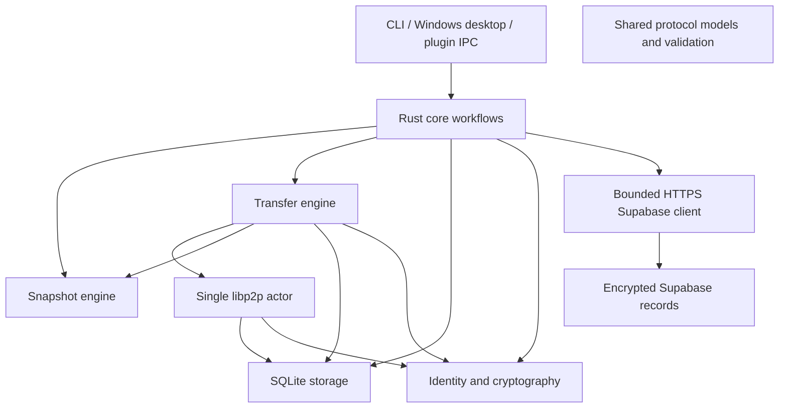

# Architecture and invariants

Foundation phases 1–8 name the original CLI/Desktop/VST3 and infrastructure implementation. Aşama 1 M0–M10 names the direct-P2P plan; #NN identifies review/UX tasks. [IMPLEMENTATION.md](IMPLEMENTATION.md) records validation and remaining integrations.

## Responsibility boundaries



All crates use shared protocol types as needed. Storage persists domain records; it does not open peer connections. Snapshot code handles local files; it does not publish metadata. Core coordinates workflows. Desktop commands and the VST3 Named Pipe bridge are adapters sharing their owner's Engine and network handle. Networking, blocking disk work, plugin IPC and UI remain separately owned; the audio callback only passes audio buffers.

Private peers authenticate through QUIC or Noise. TCP uses Yamux. Files move only over direct QUIC/TCP connections between online collaborators, with no public DHT or multicast discovery. The swarm has no relay client, DCUtR hole punching or rendezvous; relay client and server code are kept unbuilt in `future/` and [deferred to post-1.0](plans/post-1.0.md#relay). Optional per-user Supabase stores small encrypted invite drops, endpoint records and head hints.

## Setup roles and documentation

The [setup entry point](setup/README.md) separates [sender/host preparation](setup/host/README.md) from [receiving peer preparation](setup/peer/README.md). Host means the source of the first snapshot, not a central server or a persistent master role. The receiver initiates the first connection to the reachable source. An established connection carries authorized project requests both ways; independent reverse dialing after disconnect needs its own reachable path. Each CLI network job stops its runtime on completion; Desktop/serve keep explicit sessions.

Current Desktop setup is Link folder → Invite collaborator → open or paste the v2 link → Accept → automatic signed device request → explicit Approve. The link carries the Supabase service reference, publishable key and drop ID, with the invite decryption key in its fragment. Its encrypted drop can be consumed once within 15 minutes. Native code downloads, decrypts and validates the signed invitation without exposing it to React. Import persists the local project/peer row; connection and verified equality remain separate facts. Supabase endpoint records provide authenticated updates for existing collaborators after address changes. Starting Desktop alone notifies no uninvited recipient.

Approval creates the first snapshot when the inviter has files and no snapshot. An empty, available, never-received folder receives its first version automatically from an approved online peer. Later receives require Get collaborator's version and the DAW-closed confirmation. Divergence requires Use …'s version or Keep mine. Native invitation files and CLI join/request-pairing remain Advanced paths; manual card exchange is legacy. There is no public directory, browser deployment, offline pairing queue, permanent background service or automatic merge.

Pending pairing candidates are proof-verified public identities held only in an ephemeral core window, with no per-candidate live indicator or audit history. Approved peers appear in the local collaborator list; Desktop displays current route/transport for the selected peer. Unimported recipients and unauthorized network attempts are not exposed as an inbox. Native approval changes local project authorization and automatically queues a Supabase membership grant when configured.

The first Invite or Accept asks permission to attempt a time-limited UPnP mapping. Settings → Advanced holds manual port forwarding; shared router/firewall troubleshooting lives in the setup entry point. The installer adds two inbound allow rules for `trackmesh-desktop.exe` on TCP/UDP 43101 for every network profile and removes them on uninstall; the app itself only observes firewall state. On a network Windows marks as Public, Desktop warns at start and asks whether to keep using TrackMesh there ([SECURITY.md](SECURITY.md)). [The peer package template](setup/peer/CLAUDE.md) drives native CLI operations without exposing invitation payloads to the agent; the root [CLAUDE.md](../CLAUDE.md) routes repository development.

## Local snapshot commit

1. Acquire the Windows project lock; refuse snapshotting during recovery.
2. Inventory/hash the folder using fixed chunks; reject unsafe paths/reparse points and unstable files.
3. Persist verified chunks to the local content store.
4. Sign the complete immutable manifest. Unchanged files reuse the current snapshot.
5. Commit snapshot, files, chunk index/catalog, and new local head in one SQLite transaction with an expected-head check.
6. Authored snapshots keep the legacy `PENDING` metadata value; nothing publishes it. Version notices travel as direct notices or encrypted Supabase head hints, and status reports no pending publications.

The scanner omits only Ableton `.asd` analysis files, the top-level `Backup/` tree, and Windows/macOS metadata files (`desktop.ini`, `Thumbs.db`, `ehthumbs.db`, `.DS_Store`). These files neither delay save settlement nor enter new manifests. Older signed manifests remain unchanged; comparisons filter those paths on both sides, and receive leaves ignored files in the working folder without moving or overwriting them. A folder with no remaining project files cannot be shared as its first snapshot.

The working folder may change after a snapshot. Retained chunk data keeps the committed snapshot retrievable. Automatic pruning is outside the current implementation.

An accepted `SAVE_OBSERVED` starts a bounded project job. Observations coalesce for a two-second quiet period (60-second debounce limit); new observations during active work request a settled follow-up pass. With the same project lock/recovery guard held, a blocking worker samples path/size/mtime inventory every 500 ms until it has been unchanged for two seconds and Windows read handles deny active writers. Settlement has a 60-second wait limit and at most three guarded scanner attempts. Hashing a stable large project may exceed the wait limit; partial manifests never commit. Unchanged content reuses its head. This is triggered by IPC events, with no continuous filesystem watcher. A quiet inventory is a conservative heuristic, not proof of host save completion.

## Metadata publication and refresh

The optional Supabase backend uses signed claim, grant, revoke, endpoint and head operations. A persisted imported-project marker prevents an invite recipient from claiming ownership; locally created projects claim first. Membership grants and creator-side revokes share a durable actor sequence and retry queue. Revoke removes local trust immediately and queues the server operation; it does not rotate the project key. Removed devices retain previously received files and keys. A missing background Edge Function is shown by name in Advanced.

Supabase head hints are encrypted, signed metadata held in memory after validation. They do not advance local history or establish online equality. Their presence can show a newer offline version; the source must be online to transfer its files.

Refresh, validation and storage work run in blocking workers outside the swarm. There is no self-hosted announcement mailbox; its client is kept unbuilt in `future/mailbox-client/` and its service in `future/mailbox-service/`.

Desktop close hides the window and releases its explicit window session. Starting desktop again shows that same owner and retains an explicit window session until the next close. Plugin-launched desktop uses `--plugin-owner`; repeat plugin launches do not manufacture an explicit window session. With no window session, bound plugin, accepted desktop/plugin job or active peer response, 60 quiet seconds precede shutdown. Plugin and responder activity epochs capture short operations between lifetime polls. Idle IPC shutdown claims the same lock as connection/job acceptance. Shutdown drains local work before stopping metadata and the single peer runtime. There is no installed permanent service.

The foundation mailbox and relay/rendezvous services are outside the build in `future/`; [PHASE3.md](PHASE3.md) keeps their historical details.

## Receive and recovery

```text
authenticate/authorize → validate signed ancestry → reject divergence/local edits
→ acquire/retain project lock → rehash cache → download missing chunks
→ assemble and full-file-verify staging data → persist journal
→ SQLite recovery marker + APPLYING → BACKUP → INSTALL → COMMIT → DONE
→ clear recovery marker + COMPLETE → optional online peer equality ACK
```

The normal receive path still refuses local edits and divergent histories. An explicit, confirmed “Use collaborator's version” path first snapshots changed local work without announcing it, then permits a divergent target while retaining the same signed ancestry checks, project lock, clean-base validation and apply journal. The previous files remain in the transfer's sibling `backup` folder. Projects are never merged and no divergence is silently overwritten.

- A chunk is complete only after hash verification and durable chunk-store installation. SQLite progress is not a substitute for rehashing the cache on resume.
- Staging and backups are siblings of the project on its volume. Backups are retained. Only empty directories are removed; no recursive deletion applies snapshots.
- Original files are reverified while a Windows handle denies writers. Installed files arrive by atomic rename from complete, verified staging files.
- The journal is fsynced and atomically replaced. Its identifiers/file lists must match the signed target and local base.
- `begin_apply` sets recovery-required and `APPLYING` together before any original moves. `commit_local` advances history only after a full final-folder scan matches the signed manifest.
- An interrupted `INSTALL` verifies already installed files instead of recreating moved staging files. Recovery works without a peer connection.
- Blocking apply retains the project lock even if its asynchronous caller is cancelled. DAW closure is a user prerequisite, not an automatic host lock guarantee.
- A transfer can be locally complete while its source is unavailable for the final equality ACK. Completion and online verification are distinct facts.

## State contracts

| Contract | Owner | Stable values |
| --- | --- | --- |
| Transfer session | `storage::TransferState` | `QUEUED`, `RECEIVING`, `PAUSED`, `APPLYING`, `RECOVERY_REQUIRED`, `COMPLETE` |
| Apply journal phase | `transfer::journal::ApplyPhase` | `BACKUP`, `INSTALL`, `COMMIT`, `DONE` |
| Snapshot location | SQLite | `LOCAL`, `REMOTE` |
| Metadata status | SQLite | `PENDING`, `PUBLISHED`, `REMOTE` |
| Lineage | `storage::Lineage` | `EQUAL`, `REMOTE_AHEAD`, `LOCAL_AHEAD`, `DIVERGED`, `UNKNOWN` |
| Connection route | Network status | `DIRECT`, `OFFLINE` |

Typed transfer state conversion preserves existing schema-v2 text/JSON labels; unsupported persisted values produce an error. It does not introduce a new transition framework or schema migration. Receiver/apply/storage methods explicitly own transitions and transactions.

## Trust and compatibility rules

- The signed application public key must derive the advertised PeerId. Device UUID bindings cannot silently replace keys. A project supports this device plus at most two explicitly paired devices.
- Transport allow lists include paired devices only. An explicit short-lived pairing window permits at most four temporary inbound connections for enrollment only; outbound discovery still uses trust. Every inbound/outbound project request also checks project authorization.
- Every fetched manifest/ancestor validates structure, manifest hash, Ed25519 signature, project/requested snapshot ID, and trusted author key. An own-device author must match the own public key too.
- Signed invitations keep `mailbox_url` and `relay_address`: new invitations write them empty and import ignores them. SQLite keeps the `mailbox_url`/`relay_address` columns and `mailbox_state` table unread.
- Preserve protocol version, domain separators, signing bytes, field order, AAD, binary framing, manifest/chunk limits, and relative-path validation when moving code.
- Preserve SQL transaction boundaries, expected-head checks, schema version, durable filenames, and journal fields. A refactor alone is not a format migration.
- `PUBLISHED` is a legacy value written only by the removed mailbox client. Received copies are `REMOTE`; direct transfer is not publication.
- `UP TO DATE` requires fresh contact and verified equality. Offline views show last-known history and last verification; they cannot promise a download from an offline source.

Automatic enrollment is core-owned in `crates/core/src/pairing.rs`; [security details](setup/PAIRING_SECURITY.md) describe the isolated `/trackmesh/pairing/1` channel. It shares the single swarm and leaves transfer/invitation/card serialization and database values unchanged. The native Desktop opens the window and presents candidates; approval calls existing core pairing/storage authorization.

## Advisory project presence (#49)

Core owns presence in `crates/core/src/presence.rs`. The one additive `PeerRequest::Presence { project_id, working, since, source }` carries only activity, Unix seconds and `plugin`/`folder`; it sends no paths, file names or DAW details. It uses the existing bounded transfer request channel and existing `SnapshotNoticed` acknowledgement. Both the network actor and core authorize the sender exactly as for SnapshotAvailable: a trusted member of that project. Received signals, local baselines, traversal cursors and unsupported-peer suppression are memory-only; there is no SQLite/Supabase change. Presence never decides lineage or whether installation is safe.

A live bound plugin session is the main signal. Without one, a blocking worker checks metadata at most once per 60 seconds per project, skipping ignored paths and reparse points. It holds the existing project lock, skips unfinished transfers/recovery and reads no file contents or hashes. Each pass stops at 5,000 entries or approximately 200 ms; retained directory iterators resume on the next pass, including inside large individual directories. Individual OS metadata calls can exceed the approximate time budget. Traversal is limited to 128 directory levels. The in-memory baseline is the later of the local head's creation time and this device's last completed Get/apply/recovery; the latter also reads existing COMPLETE transfer timestamps, without changing stored data, so a process restart or cancellation after apply does not count received files. A file mtime newer than that baseline and within the last ten minutes is only a metadata estimate of local work. Touching unchanged content can give false warnings; large trees, nested same-size edits, unchanged/preserved mtimes, very deep folders and clock differences can delay or miss detection. These warnings do not prove content difference or absence of another editor.

Presence sends on changes and refreshes every 60 seconds while working, to online trusted project peers only. Folder activity expires after ten minutes; after the last plugin session ends the plugin signal has a two-minute quiet grace, while edits made after the session ends continue to use the folder rule. Received signals expire after three minutes without refresh, disappear offline, and cannot survive a connection generation change. Any failed presence request silently suppresses all presence sends to that peer until reconnect, with one additional attempt after ten minutes. An unknown enum variant causes a codec/read error for that request stream; the pinned libp2p request-response handler reports stream failure without closing the peer connection or other transfer streams. This is source-inspection evidence; live old/new peer operation remains unverified.

Desktop cards and the plugin status area display the Rust-derived warning, with local-time rendering of `since`; both-working warnings use danger styling. Explicit Desktop/plugin Share asks first, while automatic DAW Share continues without a dialog. Get remains available and adds a newer-version hint. Defaulted additive PluginStatus fields preserve old plugin/agent parsing. Plugin-started Desktop owners transition into the existing tray session after idle grace, reusing the persisted first-tray notice, and remain available until confirmed Quit/Close safely. CLI-only owners keep their existing idle exit; incoming advisory refreshes do not reset that grace.

Actual module owners are listed in [CODEMAP.md](CODEMAP.md). Full accepted scope is in [MVP.md](MVP.md).
